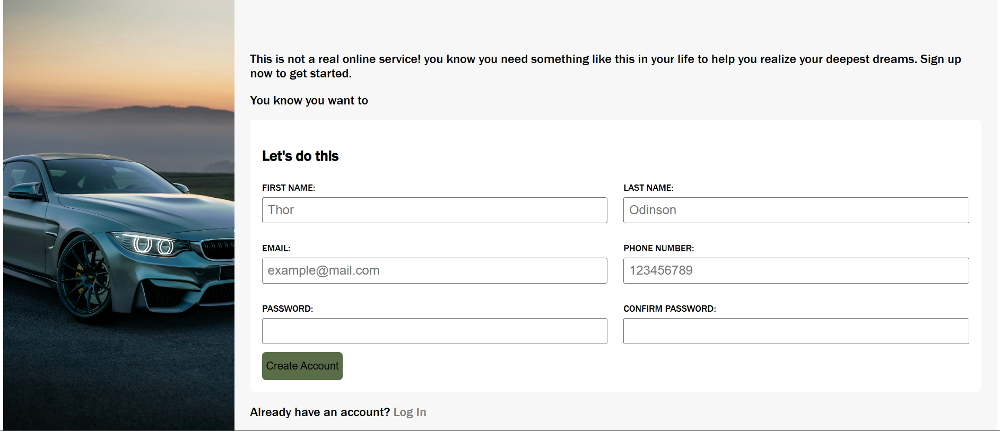

# Sign-up Form

A simple sign-up form built with HTML and CSS as part of [The Odin Project](https://www.theodinproject.com/) Intermediate HTML and CSS curriculum.

## Project Overview

This project involves creating a sign-up form for a fictional online service. It provides users with a form to enter their personal information, including their first name, last name, email address, phone number, and password.

The main goal of this project is to practise building and styling HTML forms while improving my understanding of CSS layouts and form validation.

## Features

- User registration form.
- First name and last name fields.
- Email address and phone number fields.
- Password and confirm password fields.
- Required field validation.
- Custom form styling.
- Responsive layout (in progress).

## Technologies Used

- HTML5
- CSS3
- Flexbox

## What I Learned

Through this project, I practised:

- Creating structured HTML forms.
- Using labels and input elements.
- Working with different HTML input types.
- Using CSS Flexbox to create layouts.
- Styling form elements and buttons.
- Working with CSS pseudo-classes such as `:focus` and `:user-invalid`.
- Understanding basic HTML form validation.

## Project Structure

```text
sign-up-form/
│
├── index.html
├── style.css
├── img/
│   └── background.jpg
└── README.md
```

## Live Demo

[View Live Demo](https://lhastbhorne.github.io.sign-up-form/)

## Screenshots



## Acknowledgements

- [The Odin Project](https://www.theodinproject.com/) for providing the project challenge and learning resources.

---

**Author:** LhastBhorne
